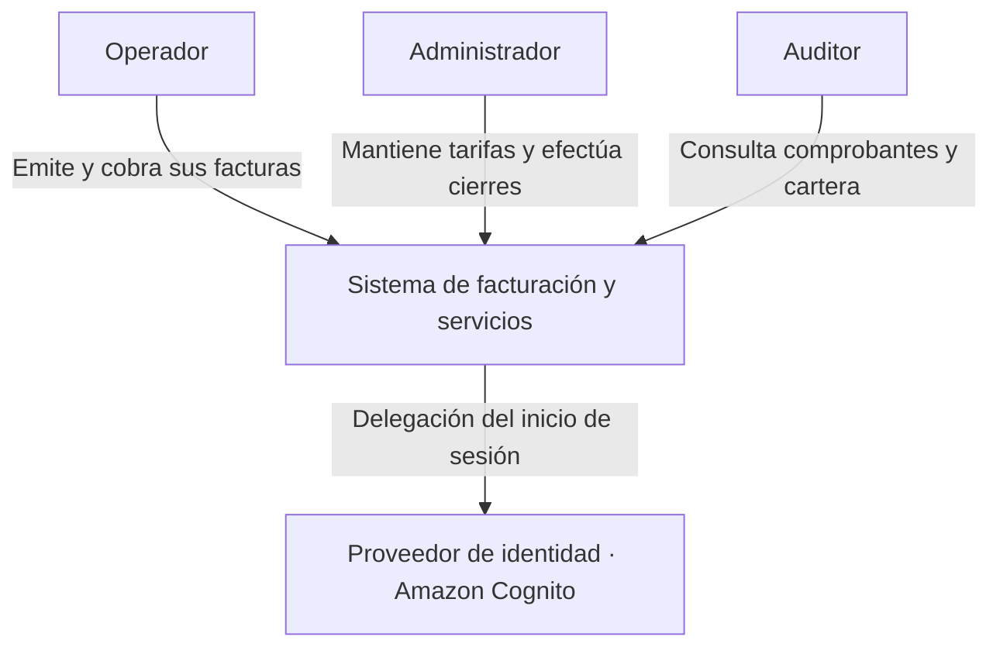
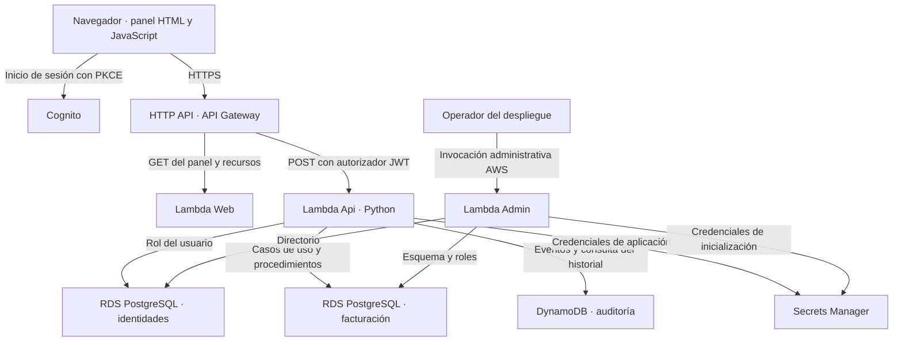
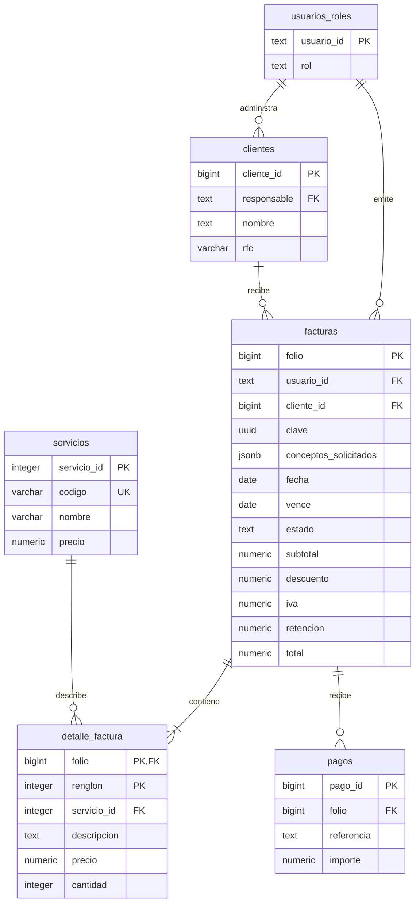
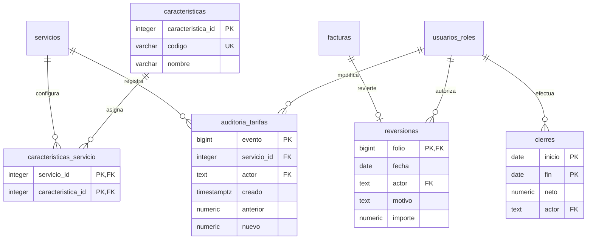
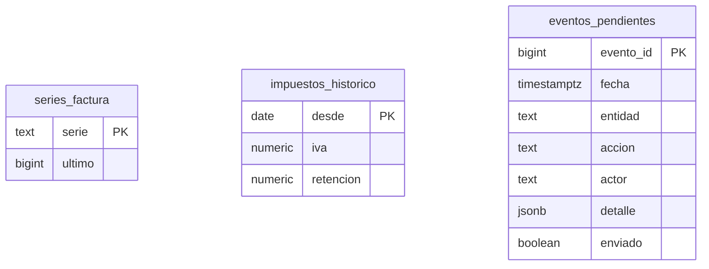
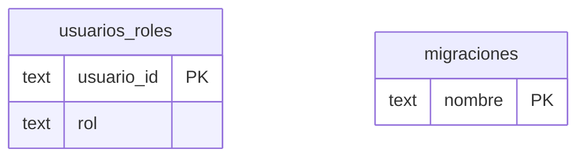

# Arquitectura del Sistema de Facturación y Servicios

## Contexto C4

Los comprobantes del proyecto son estructuras JSON de demostración académica. El alta de cliente valida el formato y la fecha del RFC. Cognito autentica a la persona y el backend consulta su rol en el directorio de la aplicación.

## Contenedores C4 y despliegue en AWS

El operador del despliegue se autentica en AWS. Lambda Admin se invoca mediante AWS y carece de ruta en la API pública de la pila. Las Lambdas Api y Admin están en la VPC y llegan a PostgreSQL en el puerto 5432. La plantilla usa dos subredes privadas, un endpoint de interfaz para secretos y uno de gateway para DynamoDB. El panel llama a la API con un token de acceso. La API compara el rol del directorio con su copia operativa antes de ejecutar el caso de uso. La configuración efectiva del laboratorio y sus permisos se verifican por separado. [Operación en AWS](conexion-aws.md)

### Recorrido de un pago

1. El panel confirma folio, referencia e importe en centavos y envía `POST /api/pago`.
2. API Gateway valida el JWT. La Lambda toma el identificador de usuario del token y un bloqueo compartido por usuario en facturación. Lee el rol con la cuenta de consulta del directorio y verifica la copia operativa. Una discrepancia interrumpe la operación.
3. `backend/servicios.py` valida la entrada. `backend/rds.py` pasa valores parametrizados al procedimiento `registrar_pago`, que comprueba acceso, saldo y duplicados. Un disparador escribe el evento pendiente en la misma transacción.
4. La API confirma la transacción e intenta exportar un lote a DynamoDB antes de devolver el comprobante. Si el envío falla, el evento sigue pendiente hasta una operación posterior.

La Lambda Admin toma un bloqueo exclusivo al modificar el rol de un usuario. Si el directorio y la copia operativa quedan distintos tras un fallo entre sus dos transacciones, una persona autorizada debe verificar y reconciliar la asignación. [Recuperación de altas](seguridad-despliegue.md)

## DER de facturación · 14 tablas

Los diagramas agrupan las tablas de una misma RDS. Una entidad puede reaparecer para mostrar sus relaciones en otro grupo. Las marcas PK y FK identifican claves primarias y foráneas del DDL. Cuando varias columnas llevan PK, forman una sola clave compuesta.

### Clientes, facturas y cobros

El esquema impone unicidad en `clientes(responsable,rfc)`, `facturas(usuario_id,clave)` y `pagos(folio,referencia)`. El procedimiento de emisión exige entre uno y treinta conceptos por solicitud. El detalle conserva el precio y la descripción vigentes en la emisión.

### Catálogo, reversiones y cierres

### Folios, vigencias y exportación de eventos

Estas tres tablas son independientes en el DDL. `emitir_factura` bloquea la fila de la serie al reservar el folio. `calcular_importes` lee la tasa vigente al emitir. Los disparadores en facturas, pagos, reversiones y auditoría de tarifas crean entradas en `eventos_pendientes`. El índice parcial de eventos pendientes acelera la selección de lotes por exportar.

## DER de identidades · 2 tablas

El directorio persiste el identificador de Cognito y el rol. `migraciones` registra la inicialización del directorio. La tabla homónima `usuarios_roles` en facturación permite las FK locales. La aplicación verifica la coincidencia entre ambas instancias para cada operación.

## Modelo de DynamoDB

La tabla de auditoría usa `entidad` como clave de partición y `evento` como clave de orden. El valor de evento combina la fecha UTC y el identificador PostgreSQL para que un reintento use la misma clave. El índice secundario `historial` usa `listado` y `evento` y devuelve hasta los 100 eventos recientes. [Esquema DynamoDB](../database/dynamodb.json)

## Preguntas para el examen
- Datos. Explica la diferencia entre el folio y la clave de reintento. Sigue el bloqueo de serie y el índice único en emitir_factura.
- Backend. Sigue el sub de Cognito desde API Gateway hasta el filtro de permisos en backend/identidades.py y backend/servicios.py. Explica quién decide si un pago es duplicado.
- Frontend. Sigue un renglón desde el formulario hasta el comprobante e identifica dónde se aplica textContent y dónde se valida el RFC otra vez.
- AWS. Dibuja los dos recorridos, HTML público y operaciones con JWT. Explica cómo se recupera un evento si falla DynamoDB después de guardar la factura.
