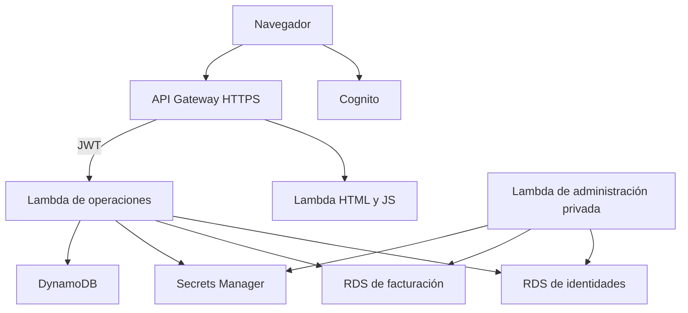

# Arquitectura de la entrega
## Contexto
El operador emite y cobra las facturas de su ámbito. El administrador mantiene servicios, autoriza cancelaciones y efectúa cierres. El auditor consulta reportes y registros. Cognito identifica a cada persona. Los datos de práctica y los comprobantes JSON se destinan a demostración académica.

## Contenedores y límites de red

La Lambda de operaciones comprueba el rol y la propiedad de cada registro. El navegador envía cantidades y claves de reintento. RDS fija importes y restricciones. El archivo de inicio y los recursos estáticos son públicos. Todas las operaciones con datos exigen un token de acceso. La red tiene dos subredes privadas, un endpoint de interfaz para secretos y uno de gateway para DynamoDB.

