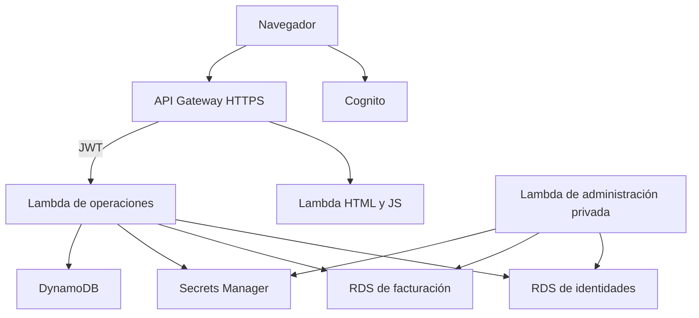
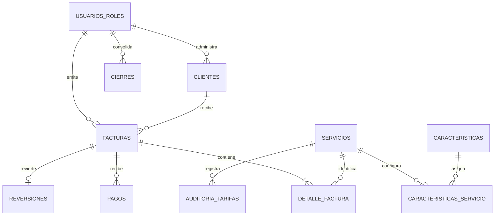

# Arquitectura de la entrega
## Contexto
El operador emite y cobra las facturas de su ámbito. El administrador mantiene servicios, autoriza cancelaciones y efectúa cierres. El auditor consulta reportes y registros. Cognito identifica a cada persona. Los datos de práctica y los comprobantes JSON se destinan a demostración académica.

## Contenedores y límites de red

La Lambda de operaciones comprueba el rol y la propiedad de cada registro. El navegador envía cantidades y claves de reintento. RDS fija importes y restricciones. El archivo de inicio y los recursos estáticos son públicos. Todas las operaciones con datos exigen un token de acceso. La red tiene dos subredes privadas, un endpoint de interfaz para secretos y uno de gateway para DynamoDB.

## Recorrido de un pago
La API obtiene el identificador validado por Cognito. Toma un bloqueo compartido por usuario en facturación y lee el rol desde la segunda RDS con una cuenta de solo lectura. Verifica que coincide con la copia operativa en facturación, que conserva las claves foráneas y las comprobaciones SQL. Si el directorio falla, la operación se interrumpe. servicios.pago valida los centavos y la referencia. FacturacionPostgres.registrar_pago llama al procedimiento que controla saldo y duplicados en una transacción. El alta de roles usa un bloqueo exclusivo sobre el mismo usuario. Si falla entre los dos commits, repetir el alta reconcilia el rol.

## Modelo relacional

Series_factura reserva el folio con bloqueo de fila. Impuestos_historico se consulta por vigencia al emitir. El detalle conserva los importes originales. Eventos_pendientes recibe los eventos dentro de la misma transacción. La aplicación los entrega a DynamoDB con una escritura condicional y reintenta lotes pendientes con operaciones posteriores. El índice historial permite consultar los 100 eventos más recientes del laboratorio.

## Preguntas para el examen
- Datos. Explica la diferencia entre el folio y la clave de reintento. Sigue el bloqueo de serie y el índice único en emitir_factura.
- Backend. Sigue el sub de Cognito desde API Gateway hasta el filtro de permisos en backend/identidades.py y backend/servicios.py. Explica quién decide si un pago es duplicado.
- Frontend. Sigue un renglón desde el formulario hasta el comprobante e identifica dónde se aplica textContent y dónde se valida el RFC otra vez.
- AWS. Dibuja los dos recorridos, HTML público y operaciones con JWT. Explica cómo se recupera un evento si falla DynamoDB después de guardar la factura.
